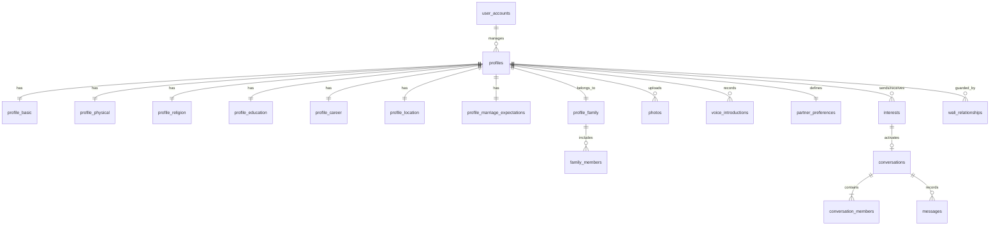

# Dono Jaha — Database Architecture & Entity Relationship Model

**Product:** Dono Jaha (D O N O   J A H A)  
**Database Engine:** PostgreSQL 15+ (via Supabase)

---

## 1. Relational Entity Overview

The schema is divided into 8 logical modules to prevent massive, unmaintainable tables:

1. **Identity & Profile Core:** `user_accounts`, `profiles`
2. **Profile Details:** `profile_basic`, `profile_physical`, `profile_religion`, `profile_education`, `profile_career`, `profile_location`, `profile_marriage_expectations`
3. **Family Structure:** `profile_family`, `family_members`
4. **Media & Privacy:** `photos`, `photo_access_requests`, `voice_introductions`, `voice_access_requests`
5. **Partner Preferences:** `partner_preferences`, `partner_preference_weights`
6. **Interests & Shortlists:** `interests`, `shortlists`
7. **The One-Conversation Engine:** `conversations`, `conversation_members`, `messages`
8. **Wali & Governance:** `wali_relationships`, `notifications`, `blocks`, `reports`, `audit_logs`

---

## 2. Mermaid Entity Relationship Diagram

---

## 3. Database Functions & Triggers

- `process_conversation_status_change()`: Trigger executing before conversation status changes to ensure that neither profile has an active conversation elsewhere.
- `accept_interest_and_create_conversation()`: Atomic transactional stored procedure that accepts interest and initializes the active conversation.
- `end_active_conversation()`: Safely closes the active conversation and marks membership ended, restoring eligibility for subsequent connections.
- `check_message_active_conversation()`: Ensures messages can only be inserted into currently active conversations.
